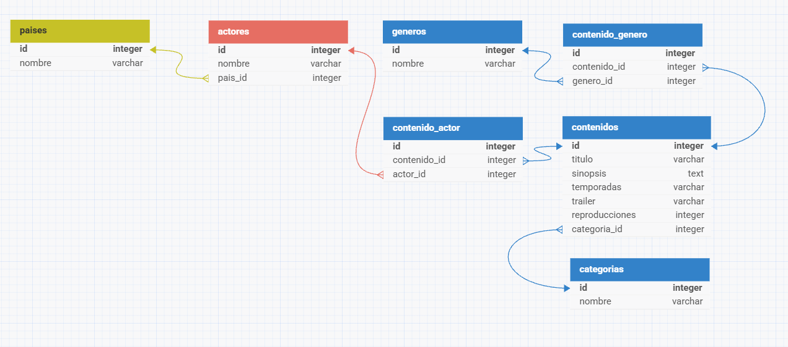

# 🎬 TrailerFlix API — Proyecto Integrador Backend

API RESTful desarrollada con **Node.js**, **Express**, **Sequelize** y **MySQL** para la gestión del catálogo audiovisual de **TrailerFlix** (películas, series, géneros, actores y países de origen).

---

## 🗄️ Modelo Relacional (Base de Datos)

La base de datos `trailerflix_db` está normalizada en **7 tablas** con integridad referencial mediante claves foráneas (`FOREIGN KEY`) y relaciones `1:N` y `N:M`:



### Estructura de Tablas
* **`contenidos`**: Tabla principal con `id`, `titulo`, `sinopsis`, `temporadas`, `trailer`, `reproducciones` y `categoria_id`.
* **`categorias`**: Clasificación del contenido (`Serie`, `Película`).
* **`generos`**: Géneros cinematográficos (`Drama`, `Acción`, `Ciencia Ficción`, `Comedia`, `Suspenso`, etc.).
* **`actores`**: Elenco registrado con `id`, `nombre` y `pais_id`.
* **`paises`**: Tabla normalizada de países de origen de los actores.
* **`contenido_genero`**: Tabla intermedia (`N:M`) entre contenidos y géneros.
* **`contenido_actor`**: Tabla intermedia (`N:M`) entre contenidos y actores.

---

## 📁 Estructura del Proyecto

```text
├── src/
│   ├── models/                 # Modelos de Sequelize (Actor, Categoria, Contenido, Genero, Pais)
│   ├── routes/
│   │   ├── contenidos/         # Controladores CRUD y filtros avanzados
│   │   │   ├── create.js
│   │   │   ├── delete.js
│   │   │   ├── getAll.js
│   │   │   ├── getByActor.js
│   │   │   ├── getByCountry.js
│   │   │   ├── getById.js
│   │   │   ├── getByTitle.js
│   │   │   ├── getTop10.js
│   │   │   └── update.js
│   │   └── index.js            # Enrutador principal
│   ├── app.js                  # Configuración de Express, middlewares y asociaciones
│   └── database.js             # Conexión a MySQL mediante Sequelize
├── .env.example                # Plantilla de variables de entorno
├── .gitignore                  # Exclusión de node_modules y .env
├── Modelo-Relacional.png       # Diagrama Entidad-Relación
├── package.json                # Dependencias y scripts
├── trailerflix_db.sql          # Script SQL completo (estructura + datos)
└── README.md                   # Documentación del proyecto

```

---

## 🚀 Endpoints Disponibles

| Método | Endpoint | Descripción | Códigos de Respuesta |
| :--- | :--- | :--- | :--- |
| **GET** | `/` | Mensaje de bienvenida y verificación del servidor | `200 OK` |
| **GET** | `/api/contenidos` | Lista todos los contenidos con su categoría, géneros y reparto | `200 OK`, `500 Error` |
| **GET** | `/api/contenidos/top10` | Devuelve el ranking Top 10 ordenado por reproducciones | `200 OK`, `500 Error` |
| **GET** | `/api/contenidos/actor/:nombre` | Filtra contenidos por coincidencia parcial en el nombre del actor/actriz | `200 OK`, `404 Not Found`, `500 Error` |
| **GET** | `/api/contenidos/titulo/:titulo` | Busca contenidos por coincidencia parcial en el título | `200 OK`, `404 Not Found`, `500 Error` |
| **GET** | `/api/contenidos/pais/:pais` | Filtra contenidos según el país de origen de sus actores | `200 OK`, `404 Not Found`, `500 Error` |
| **GET** | `/api/contenidos/:id` | Obtiene el detalle completo de un contenido por su `id` | `200 OK`, `404 Not Found`, `500 Error` |
| **POST** | `/api/contenidos` | Crea un nuevo contenido en el catálogo | `201 Created`, `400 Bad Request`, `500 Error` |
| **PUT** | `/api/contenidos/:id` | Actualiza los datos y relaciones de un contenido existente | `200 OK`, `400 Bad Request`, `404 Not Found`, `500 Error` |
| **DELETE** | `/api/contenidos/:id` | Elimina un contenido por su `id` | `200 OK`, `404 Not Found`, `500 Error` |

---

## 🧪 Ejemplos de Peticiones (Requests)

### Crear un contenido (`POST /api/contenidos`)

```json
{
  "titulo": "Inception",
  "sinopsis": "Un ladrón que roba secretos corporativos a través del uso de la tecnología de compartir sueños recibe la tarea inversa de plantar una idea en la mente de un director ejecutivo.",
  "temporadas": "N/A",
  "trailer": "[https://www.youtube.com/results?search_query=Inception+trailer+oficial](https://www.youtube.com/results?search_query=Inception+trailer+oficial)",
  "reproducciones": 920,
  "categoria_id": 2
}
```

### Actualizar un contenido (`PUT /api/contenidos/:id`)

```json
{
  "titulo": "El Eternauta",
  "sinopsis": "Una nevada tóxica cae sobre Buenos Aires y mata a casi toda la población. Un grupo de sobrevivientes debe organizarse para resistir a una invasión extraterrestre.",
  "temporadas": "2",
  "trailer": "[https://www.youtube.com/results?search_query=El+Eternauta+serie+trailer+oficial](https://www.youtube.com/results?search_query=El+Eternauta+serie+trailer+oficial)",
  "reproducciones": 950,
  "categoria_id": 1
}
```